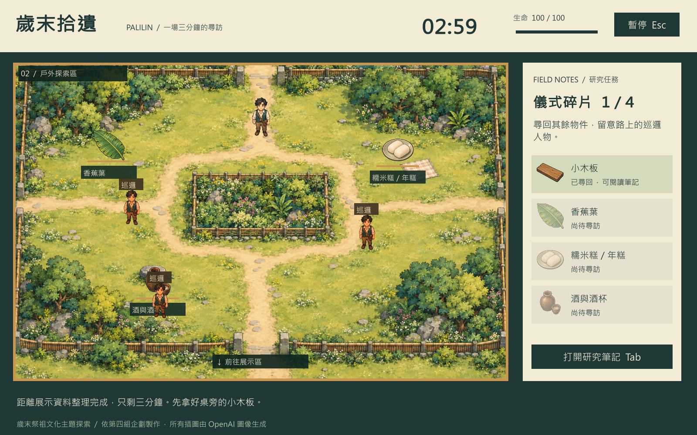

# 歲末拾遺

依第四組《歲末拾遺》計劃書製作的 Unity 2D 俯視角單人限時探索遊戲。



Windows 執行檔與完整交付包請至本 repository 的 **Releases** 下載。此 repository 根目錄就是 Unity 專案；clone 後可直接由 Unity Hub 加入。

## 直接遊玩

開啟同一交付包內 `Windows/YearEndGathering.exe`。請保留整個 Windows 資料夾，不能只搬走 exe。

- WASD 或方向鍵：移動；斜向速度已正規化。
- 碰觸物件：自動拾取，一項只計算一次。
- Tab：開關研究筆記；點擊右側物件卡片也可閱讀。
- Esc：暫停／繼續；切到其他視窗時自動暫停。
- F3：顯示碰撞區域，供開發檢查。

1. 在研究室取得桌旁的小木板，再從下方出口離開。
2. 戶外搜尋香蕉葉、糯米糕／年糕、酒與酒杯；避開三位巡邏人物。
3. 從戶外下方出口進入展示區，走到中央陳列桌前完成整理。
4. 未集齊四項時，可從展示區下方出口返回戶外；戶外上方可返回研究室。

每局 180 秒、100 HP；巡邏人物接觸扣 20 HP，受傷後 1.25 秒無敵。場景切換保留蒐集、HP、剩餘時間。時間或 HP 歸零立即失敗；全部四項且時間與 HP 大於零才能成功。

結算分數：`已取得物件數 × 100 + 剩餘整秒 × 10 + 剩餘 HP × 5`。勝敗均提供重新開始及離開按鈕。

## 開啟專案

Unity Hub → Add project from disk → 選擇本資料夾 `YearEndGathering`，使用 **Unity 6000.6.2f1**。

開啟 `Assets/Scenes/ResearchRoom.unity` 後按 Play。遊戲會自動建立常駐管理物件；切換三個實體 Unity Scene。美術存放於 `Assets/Resources/Art`。UI 使用 Unity IMGUI，障礙採具有子步進的軸向 AABB 碰撞，防止穿越；不依賴額外付費插件或網路服務。

中文使用 Windows 的 Microsoft JhengHei 字型，專案不散布系統字型。建置目標為 Windows x64。遊戲以 1600×1000 為設計基準，視窗縮放時等比例映射各軸介面。

## 驗證及重新建置

Unity 上方選單：

- `歲末拾遺 → 驗證規則與關卡`：執行規則、地圖可達性、巡邏路線、碰撞及美術載入檢查。
- `歲末拾遺 → 建立場景與 Windows 版本`：先驗證，再建置至專案旁的 Windows 資料夾。

亦可在 PowerShell 執行：

```powershell
& 'C:\Program Files\Unity\Hub\Editor\6000.6.2f1\Editor\Unity.exe' -batchmode -nographics -quit -projectPath '專案絕對路徑' -executeMethod ProjectPipeline.BuildAndVerify -logFile '建置紀錄絕對路徑'
```

執行檔整合檢查：

```powershell
& '.\Windows\YearEndGathering.exe' --smoke-test -logFile '.\player-test.log'
```

測試會檢查實際場景載入、物件、資料保留、暫停與無敵，將 `smoke-test.txt` 和實際遊戲截圖輸出至 Windows 資料夾後自動退出。規則檢查結果見 `Verification.txt`，交付驗證摘要見包內 `驗證紀錄.md`。

## 美術與文化來源

**所有遊戲插圖均以 OpenAI 內建 image_gen 工具生成，未採用其他圖庫、網路圖片或 Unity 素材包。** 四個原始 PNG 保留於專案；角色與物件從同一張透明 atlas 取樣，巡邏人物使用同一研究人員美術加暖色提示。方向切換配合步行浮動，並非逐格骨架動畫。UI 的純色區塊、標籤和按鈕由程式繪製。提示詞及來源紀錄見 `ART_PROVENANCE.md`。

本作是資料蒐集主題的遊戲化呈現，未重現祭儀或採用未經確認的族服、神聖符號。四項物件與三場景依使用者計劃書；筆記參考公開資料並明確區分家庭訪談記錄與遊戲設定。

- 原視新聞網，〈噶瑪蘭祭祖儀式 團結家族、慎終追遠〉（2022-07-05）：https://news.ipcf.org.tw/phrase/kavalan/41889
- 蘭陽博物館，123 期〈《噶瑪蘭族》第壹部‧尋找─在成為「漢人」的邊緣〉：https://www.lym.gov.tw/ch/collection/epaper/epaper-detail/5f6d332f-19bc-11eb-94d3-2760f1289ae7/
- 計劃書原件為使用者提供的 OneDrive 文件，專案未更改原文件。

此版本具備單關卡完整流程。無存檔、線上排行榜、配音與背景音樂，這些不在計劃書的必要功能範圍內。
